# 基于微信微服务架构的汽车租赁系统的设计与实现zaxzu

> 🎓 **计算机毕业设计 · 基于微信微服务架构的汽车租赁系统的设计与实现zaxzu**
>
> 本仓库只放**项目介绍 + 运行截图**（截图是站点带水印的原图，存在仓库 `images/` 里）。
>
> 👉 **完整可运行源码 / 数据库脚本 / 部署文档：[点我获取](https://geekcode.top/archives/%E5%9F%BA%E4%BA%8E%E5%BE%AE%E4%BF%A1%E5%BE%AE%E6%9C%8D%E5%8A%A1%E6%9E%B6%E6%9E%84%E7%9A%84%E6%B1%BD%E8%BD%A6%E7%A7%9F%E8%B5%81%E7%B3%BB%E7%BB%9F%E7%9A%84%E8%AE%BE%E8%AE%A1%E4%B8%8E%E5%AE%9E%E7%8E%B0zaxzu?utm_source=github)**
>
> 💬 咨询微信：**ir9372**　|　🌐 更多项目：[极客代码 geekcode.top](https://geekcode.top/?utm_source=github)
>
> 📌 项目详情页：<https://geekcode.top/archives/%E5%9F%BA%E4%BA%8E%E5%BE%AE%E4%BF%A1%E5%BE%AE%E6%9C%8D%E5%8A%A1%E6%9E%B6%E6%9E%84%E7%9A%84%E6%B1%BD%E8%BD%A6%E7%A7%9F%E8%B5%81%E7%B3%BB%E7%BB%9F%E7%9A%84%E8%AE%BE%E8%AE%A1%E4%B8%8E%E5%AE%9E%E7%8E%B0zaxzu?utm_source=github>

<table><td width="230" align="center"> <b>扫码加微信 ir9372</b></td><td valign="middle">📦 源码 = 项目介绍 + 全部运行截图 + 数据库 + 部署文档 👉 点上方任意截图，直接跳到 <b>极客代码 geekcode.top</b> 详情页</td></table>

---

<h1>基于微信微服务架构的汽车租赁系统的设计与实现_zaxzu</h1>
<h2>项目概述</h2>

本项目旨在设计并实现一套基于微信微服务架构的汽车租赁系统，核心目标是解决传统汽车租赁业务中信息分散、流程繁琐及管理效率低下的问题。系统采用前后端分离的开发模式，后端基于 Spring Boot 框架构建 RESTful API，前端通过微信小程序提供移动端服务入口，并配套独立的后台管理界面。

主要功能涵盖车辆信息管理、在线租赁订单处理、还车记录追踪、用户收藏管理及在线客服互动等模块。适用人群包括需要便捷租车服务的普通用户以及负责运营管理的后台管理员。技术架构上，利用 Spring Boot 的稳定性与微信小程序的轻量化优势，实现了业务逻辑与用户交互的高效解耦，确保了系统在多终端环境下的流畅体验和数据一致性，为汽车租赁行业提供了一套标准化的数字化解决方案。

<h2>技术架构</h2>

本系统采用典型的 B/S（浏览器/服务器）架构结合微信小程序生态进行开发，整体技术栈以 Java 为核心，具体架构分层如下：

<strong>1. 后端服务层</strong>
基于 Spring Boot 框架搭建，作为系统的核心业务逻辑处理中心。Spring Boot 提供了自动配置和起步依赖，简化了应用搭建过程，并通过内嵌容器快速启动服务。后端主要负责处理 HTTP 请求、执行业务逻辑（如订单状态流转、库存校验）、数据持久化操作以及与数据库的交互。接口设计遵循 RESTful 规范，便于小程序端和管理端调用。

<strong>2. 前端展示层</strong>
分为两个部分：

<ul>
<li><strong>用户端</strong>：基于微信小程序原生技术栈构建。利用微信提供的组件库和 API，实现页面渲染、数据绑定及网络请求。小程序端直接对接后端 API，为用户提供浏览汽车信息、下单租赁、查看订单等功能。</li>
<li><strong>管理端</strong>：基于 Vue.js 框架开发的单页应用（SPA）。Vue 的响应式数据绑定机制使得后台管理界面的数据更新更加高效，路由管理用于切换不同的功能模块（如新闻管理、用户管理等）。</li>
</ul>

<strong>3. 数据存储层</strong>
虽然具体数据库类型未在代码上下文中显式声明，但根据 Spring Boot 常规搭配及业务特性，通常采用关系型数据库（如 MySQL）存储结构化数据，包括用户信息、车辆详情、订单记录、颜色品牌字典表等。数据模型设计注重范式规范化，确保车辆属性（颜色、品牌）与实体信息分离，提高数据复用率。

<strong>4. 通信机制</strong>
前后端通过 JSON 格式数据进行异步通信。小程序端使用 <code>wx.request</code> 发起 HTTPS 请求，管理端使用 Axios 等 HTTP 客户端库。系统支持 Token 或 Session 机制进行身份验证，确保只有授权用户才能访问敏感接口。

<a href="https://geekcode.top/archives/%E5%9F%BA%E4%BA%8E%E5%BE%AE%E4%BF%A1%E5%BE%AE%E6%9C%8D%E5%8A%A1%E6%9E%B6%E6%9E%84%E7%9A%84%E6%B1%BD%E8%BD%A6%E7%A7%9F%E8%B5%81%E7%B3%BB%E7%BB%9F%E7%9A%84%E8%AE%BE%E8%AE%A1%E4%B8%8E%E5%AE%9E%E7%8E%B0zaxzu?utm_source=github" title="查看完整源码">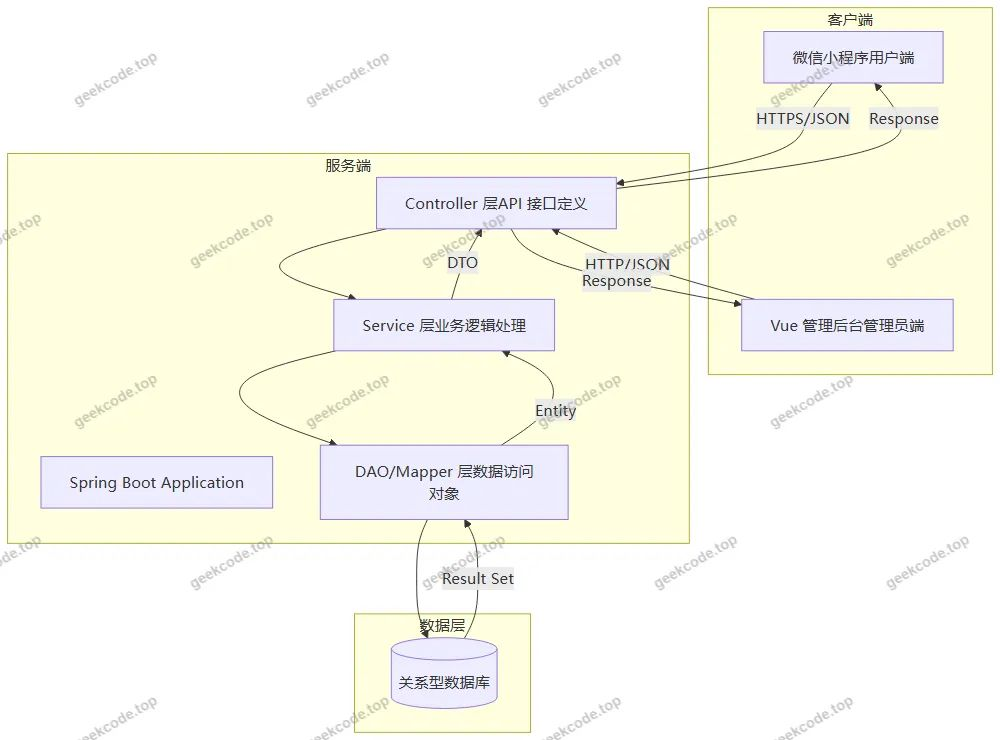</a>

<h2>功能模块</h2>

根据后台路由配置及小程序截图功能列表，系统主要划分为前台用户功能模块和后台管理功能模块两大部分。

<h3>1. 前台用户端功能模块（微信小程序）</h3>

前台面向普通租赁用户，侧重于业务流程的操作与信息获取。

<ul>
<li><strong>首页展示</strong>：聚合展示推荐车辆、最新公告及快捷入口，引导用户进入核心业务场景。</li>
<li><strong>汽车信息浏览</strong>：展示车辆详细信息，包括车型图片、价格、可用状态等，支持按条件筛选。</li>
<li><strong>公告信息</strong>：查看平台发布的租赁须知、优惠活动或系统通知。</li>
<li><strong>个人中心</strong>：</li>
<li><strong>登录/注册</strong>：用户身份认证入口。</li>
<li><strong>个人信息</strong>：修改头像、昵称、联系方式等基本资料。</li>
<li><strong>我的收藏</strong>：查看已收藏的车辆列表，方便后续快速租赁。</li>
<li><strong>租赁订单列表</strong>：查询历史及当前租赁订单的状态（待支付、进行中、已完成等）。</li>
<li><strong>还车记录列表</strong>：查看具体的还车时间及车辆归还状态。</li>
<li><strong>在线客服</strong>：提供即时通讯功能，解决用户在租赁过程中的疑问。</li>
<li><strong>支付确认</strong>：在租赁流程的最后一步，确认订单金额并进行模拟或实际支付操作。</li>
</ul>
<h3>2. 后台管理端功能模块（Web Admin）</h3>

后台面向管理员，侧重于基础数据维护、业务审核及系统配置。

<ul>
<li><strong>系统登录</strong>：管理员身份验证入口。</li>
<li><strong>首页仪表盘</strong>：展示关键业务数据统计概览（具体统计指标依实现而定）。</li>
<li><strong>用户管理 (/yonghu)</strong>：对注册用户进行增删改查，管理用户账号状态。</li>
<li><strong>车辆信息管理 (/qichexinxi)</strong>：录入和维护租赁车辆的详细档案，包括名称、描述、图片等。</li>
<li><strong>车辆品牌管理 (/cheliangpinpai)</strong>：维护车辆品牌字典，供车辆信息关联使用。</li>
<li><strong>车辆颜色管理 (/cheliangyanse)</strong>：维护车辆颜色字典，丰富车辆属性选项。</li>
<li><strong>租赁订单管理 (/zulindingdan)</strong>：查看所有用户的租赁订单，执行审核、取消或状态变更操作。</li>
<li><strong>还车记录管理 (/haichejilu)</strong>：查询和归档用户的还车日志，核对车辆回收情况。</li>
<li><strong>收藏管理 (/storeup)</strong>：查看用户对车辆的收藏记录，分析热门车型。</li>
<li><strong>公告信息管理 (/news)</strong>：发布、编辑或删除前台展示的公告资讯。</li>
<li><strong>关于我们 (/aboutus)</strong>：编辑平台简介、联系方式等静态内容。</li>
<li><strong>系统简介 (/systemintro)</strong>：配置系统的基本介绍文案。</li>
<li><strong>论坛/社区管理 (/forum)</strong>：若存在论坛功能，此处用于管理帖子和评论（依据路由推断）。</li>
<li><strong>聊天管理 (/chat)</strong>：监控或回复用户与客服的聊天记录。</li>
<li><strong>参数配置 (/config)</strong>：管理系统全局配置项，如网站标题、Logo、开关设置等。</li>
</ul>
<h2>用户角色与权限</h2>

本系统主要包含两类用户角色，不同角色拥有严格隔离的功能权限边界。

<h3>1. 普通用户（租客）</h3>
<ul>
<li><strong>身份标识</strong>：通过手机号或微信授权注册的自然人。</li>
<li><strong>权限范围</strong>：</li>
<li><strong>浏览权限</strong>：可公开访问首页、汽车信息、公告信息及“关于我们”页面。</li>
<li><strong>操作权限</strong>：</li>
<li>注册与登录系统。</li>
<li>编辑个人基本信息。</li>
<li>添加车辆至收藏夹。</li>
<li>创建新的租赁订单并完成支付确认。</li>
<li>查看自己的租赁订单历史和还车记录。</li>
<li>发起在线客服咨询。</li>
<li><strong>限制</strong>：无法访问后台管理界面，无法修改任何系统基础数据（如车辆信息、品牌、颜色），无法查看其他用户的数据。</li>
</ul>
<h3>2. 管理员（运营人员）</h3>
<ul>
<li><strong>身份标识</strong>：系统内部授权的工作人员，通过专用后台登录页进入。</li>
<li><strong>权限范围</strong>：</li>
<li><strong>全量数据管理</strong>：拥有对所有业务数据的 CRUD（增删改查）权限。</li>
<li><strong>基础数据维护</strong>：管理车辆品牌、颜色、车辆详细信息、公告内容、系统简介及“关于我们”文本。</li>
<li><strong>业务处理</strong>：审核和管理所有用户的租赁订单，查看和处理还车记录，监控用户收藏行为。</li>
<li><strong>用户管理</strong>：查看和管理所有注册用户的信息。</li>
<li><strong>沟通管理</strong>：接入聊天模块，回复用户咨询；管理论坛帖子（如有）。</li>
<li><strong>系统配置</strong>：修改系统全局参数配置。</li>
<li><strong>限制</strong>：通常不参与具体的租赁下单流程，其核心职责是维持系统运转和数据准确性。</li>
</ul>
<h2>项目特色与创新点</h2>
<ol>
<li>
<strong>微服务架构理念的应用</strong>：
   项目名称强调“微信微服务架构”，虽为单体 Spring Boot 应用，但在设计上体现了模块化思想。将车辆、订单、用户、配置等核心业务域清晰划分，各模块间通过标准 API 交互，降低了耦合度，便于后续扩展或拆分独立服务。

</li>
<li>
<strong>双端协同的业务闭环</strong>：
   实现了从“用户选车-下单-支付-还车”到“管理员录入-审核-统计-维护”的完整业务闭环。小程序端注重用户体验的轻量化与即时性，后台端注重数据管理的规范性与全面性，两者互补，覆盖了汽车租赁业务的全生命周期。

</li>
<li>
<strong>灵活的字典数据管理</strong>：
   系统将“车辆品牌”和“车辆颜色”抽象为独立的管理模块（/cheliangpinpai, /cheliangyanse）。这种设计避免了硬编码带来的维护困难，管理员可在后台动态新增品牌或颜色选项，前端无需重新发版即可实时生效，提高了系统的灵活性和可扩展性。

</li>
<li>
<strong>集成化的客户互动体系</strong>：
   内置“在线客服”（/chat）和“论坛”（/forum）相关路由，打破了传统租赁系统仅作为交易工具的局限，增强了用户粘性。通过即时通讯和内容社区，提升了售后服务的响应速度和用户参与度。

</li>
<li>
<strong>标准化后台管理界面</strong>：
   后台涵盖了从内容发布（新闻、公告）、基础配置（系统简介、关于我们）到核心业务（订单、车辆）的全方位管理功能，界面统一且逻辑清晰，降低了管理员的学习成本，提升了运营效率。

</li>
</ol>
<h2>部署环境</h2>

为了确保系统正常运行，需准备以下软硬件环境：

<strong>1. 硬件要求</strong>

<ul>
<li><strong>服务器</strong>：建议配置至少 2 核 CPU、4GB 内存、40GB 硬盘空间（可根据并发量调整）。</li>
<li><strong>开发机</strong>：普通 PC 即可，建议 8GB 以上内存以流畅运行 IDE 和模拟器。</li>
</ul>

<strong>2. 软件环境</strong>

<ul>
<li><strong>操作系统</strong>：Linux (CentOS 7/8, Ubuntu 18.04+) 或 Windows Server。</li>
<li><strong>Java 环境</strong>：JDK 1.8 或 JDK 11（推荐 JDK 1.8 以兼容大多数 Spring Boot 版本）。</li>
<li><strong>构建工具</strong>：Maven 3.6+ 或 Gradle 6.0+，用于依赖管理和项目打包。</li>
<li><strong>数据库</strong>：MySQL 5.7 或 MySQL 8.0。需安装相应的 JDBC 驱动。</li>
<li><strong>缓存（可选）</strong>：Redis 5.0+，若项目涉及会话共享或高频数据缓存则必需，否则可省略。</li>
<li><strong>前端环境</strong>：</li>
<li>Node.js 12.x - 16.x LTS 版本。</li>
<li>npm 或 yarn 包管理器。</li>
<li>微信开发者工具（最新稳定版），用于编译和调试小程序代码。</li>
</ul>

<strong>3. 第三方服务</strong>

<ul>
<li><strong>微信小程序 AppID</strong>：需在微信公众平台注册小程序账号，获取 AppID 和 AppSecret，用于配置 <code>app.json</code> 及后端鉴权。</li>
<li><strong>域名备案</strong>：生产环境下，后端 API 域名必须完成 ICP 备案，并配置 SSL 证书（HTTPS），以满足微信小程序的安全要求。</li>
</ul>
<h2>五、技术特性</h2>
<ul>
<li>前后端集成部署，前端资源打包至后端 static 目录</li>
</ul>
<h2>六、功能模块截图</h2>
<h3>微信小程序用户端</h3>

<figure><a href="https://geekcode.top/archives/%E5%9F%BA%E4%BA%8E%E5%BE%AE%E4%BF%A1%E5%BE%AE%E6%9C%8D%E5%8A%A1%E6%9E%B6%E6%9E%84%E7%9A%84%E6%B1%BD%E8%BD%A6%E7%A7%9F%E8%B5%81%E7%B3%BB%E7%BB%9F%E7%9A%84%E8%AE%BE%E8%AE%A1%E4%B8%8E%E5%AE%9E%E7%8E%B0zaxzu?utm_source=github" title="查看完整源码">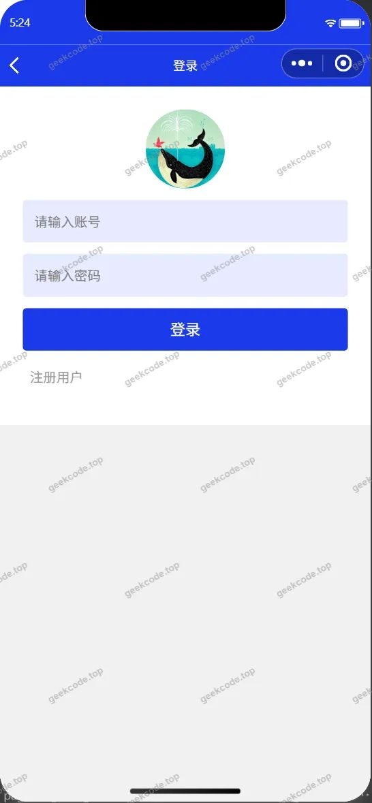</a><figcaption>小程序-登录</figcaption></figure>
<figure><a href="https://geekcode.top/archives/%E5%9F%BA%E4%BA%8E%E5%BE%AE%E4%BF%A1%E5%BE%AE%E6%9C%8D%E5%8A%A1%E6%9E%B6%E6%9E%84%E7%9A%84%E6%B1%BD%E8%BD%A6%E7%A7%9F%E8%B5%81%E7%B3%BB%E7%BB%9F%E7%9A%84%E8%AE%BE%E8%AE%A1%E4%B8%8E%E5%AE%9E%E7%8E%B0zaxzu?utm_source=github" title="查看完整源码">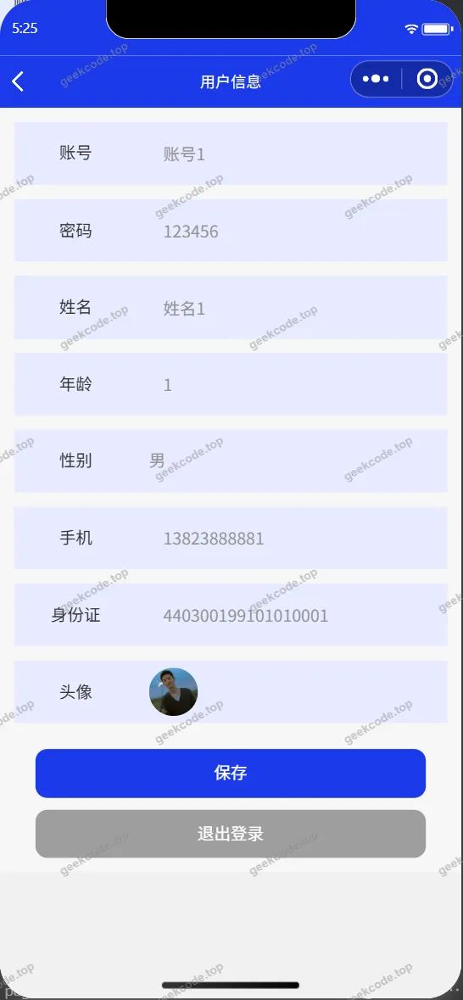</a><figcaption>小程序-个人信息</figcaption></figure>
<figure><figcaption>小程序-公告信息</figcaption></figure>
<figure><a href="https://geekcode.top/archives/%E5%9F%BA%E4%BA%8E%E5%BE%AE%E4%BF%A1%E5%BE%AE%E6%9C%8D%E5%8A%A1%E6%9E%B6%E6%9E%84%E7%9A%84%E6%B1%BD%E8%BD%A6%E7%A7%9F%E8%B5%81%E7%B3%BB%E7%BB%9F%E7%9A%84%E8%AE%BE%E8%AE%A1%E4%B8%8E%E5%AE%9E%E7%8E%B0zaxzu?utm_source=github" title="查看完整源码">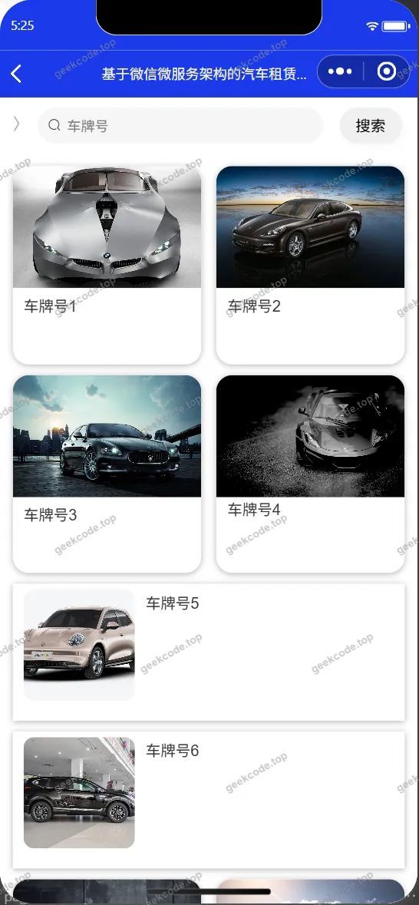</a><figcaption>小程序-还车记录列表</figcaption></figure>
<figure><a href="https://geekcode.top/archives/%E5%9F%BA%E4%BA%8E%E5%BE%AE%E4%BF%A1%E5%BE%AE%E6%9C%8D%E5%8A%A1%E6%9E%B6%E6%9E%84%E7%9A%84%E6%B1%BD%E8%BD%A6%E7%A7%9F%E8%B5%81%E7%B3%BB%E7%BB%9F%E7%9A%84%E8%AE%BE%E8%AE%A1%E4%B8%8E%E5%AE%9E%E7%8E%B0zaxzu?utm_source=github" title="查看完整源码">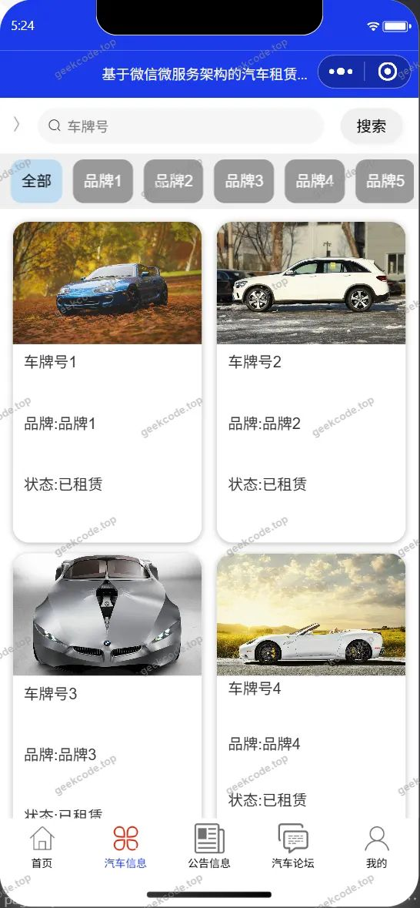</a><figcaption>小程序-汽车信息</figcaption></figure>
<figure><a href="https://geekcode.top/archives/%E5%9F%BA%E4%BA%8E%E5%BE%AE%E4%BF%A1%E5%BE%AE%E6%9C%8D%E5%8A%A1%E6%9E%B6%E6%9E%84%E7%9A%84%E6%B1%BD%E8%BD%A6%E7%A7%9F%E8%B5%81%E7%B3%BB%E7%BB%9F%E7%9A%84%E8%AE%BE%E8%AE%A1%E4%B8%8E%E5%AE%9E%E7%8E%B0zaxzu?utm_source=github" title="查看完整源码">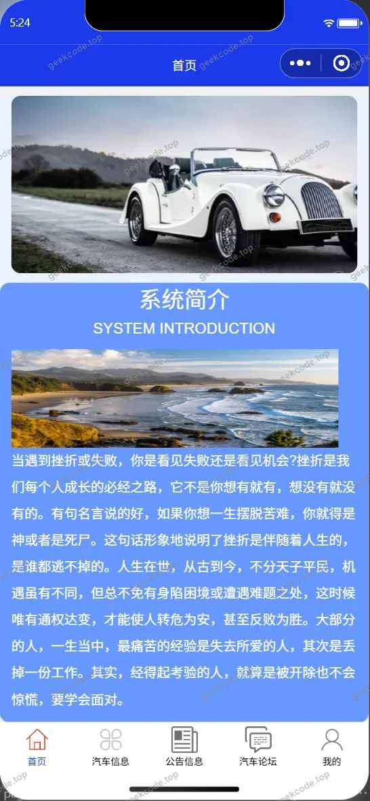</a><figcaption>小程序-首页</figcaption></figure>
<figure><a href="https://geekcode.top/archives/%E5%9F%BA%E4%BA%8E%E5%BE%AE%E4%BF%A1%E5%BE%AE%E6%9C%8D%E5%8A%A1%E6%9E%B6%E6%9E%84%E7%9A%84%E6%B1%BD%E8%BD%A6%E7%A7%9F%E8%B5%81%E7%B3%BB%E7%BB%9F%E7%9A%84%E8%AE%BE%E8%AE%A1%E4%B8%8E%E5%AE%9E%E7%8E%B0zaxzu?utm_source=github" title="查看完整源码">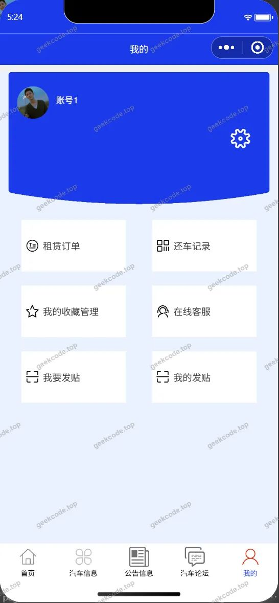</a><figcaption>小程序-我的</figcaption></figure>
<figure><a href="https://geekcode.top/archives/%E5%9F%BA%E4%BA%8E%E5%BE%AE%E4%BF%A1%E5%BE%AE%E6%9C%8D%E5%8A%A1%E6%9E%B6%E6%9E%84%E7%9A%84%E6%B1%BD%E8%BD%A6%E7%A7%9F%E8%B5%81%E7%B3%BB%E7%BB%9F%E7%9A%84%E8%AE%BE%E8%AE%A1%E4%B8%8E%E5%AE%9E%E7%8E%B0zaxzu?utm_source=github" title="查看完整源码">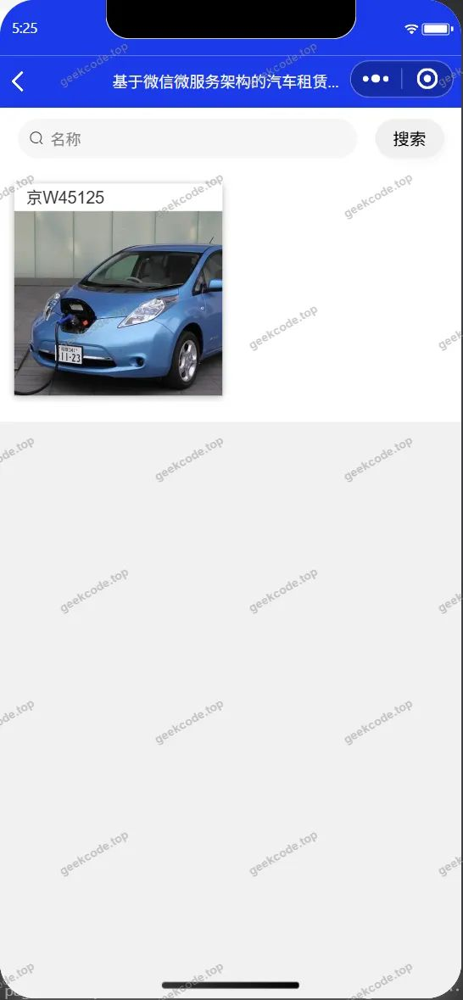</a><figcaption>小程序-我的收藏列表</figcaption></figure>
<figure><figcaption>小程序-在线客服</figcaption></figure>
<figure><a href="https://geekcode.top/archives/%E5%9F%BA%E4%BA%8E%E5%BE%AE%E4%BF%A1%E5%BE%AE%E6%9C%8D%E5%8A%A1%E6%9E%B6%E6%9E%84%E7%9A%84%E6%B1%BD%E8%BD%A6%E7%A7%9F%E8%B5%81%E7%B3%BB%E7%BB%9F%E7%9A%84%E8%AE%BE%E8%AE%A1%E4%B8%8E%E5%AE%9E%E7%8E%B0zaxzu?utm_source=github" title="查看完整源码">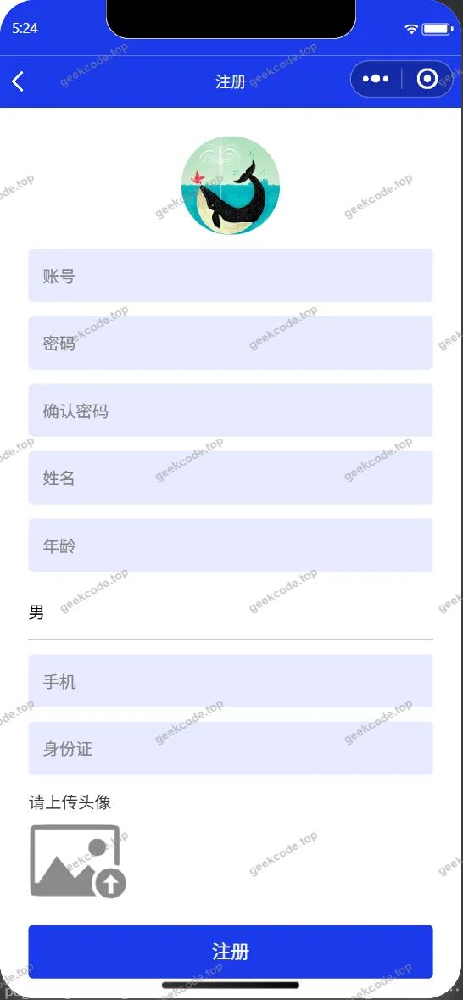</a><figcaption>小程序-注册</figcaption></figure>
<figure><a href="https://geekcode.top/archives/%E5%9F%BA%E4%BA%8E%E5%BE%AE%E4%BF%A1%E5%BE%AE%E6%9C%8D%E5%8A%A1%E6%9E%B6%E6%9E%84%E7%9A%84%E6%B1%BD%E8%BD%A6%E7%A7%9F%E8%B5%81%E7%B3%BB%E7%BB%9F%E7%9A%84%E8%AE%BE%E8%AE%A1%E4%B8%8E%E5%AE%9E%E7%8E%B0zaxzu?utm_source=github" title="查看完整源码">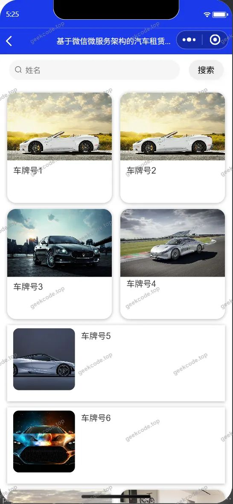</a><figcaption>小程序-租赁订单列表</figcaption></figure>
<figure><a href="https://geekcode.top/archives/%E5%9F%BA%E4%BA%8E%E5%BE%AE%E4%BF%A1%E5%BE%AE%E6%9C%8D%E5%8A%A1%E6%9E%B6%E6%9E%84%E7%9A%84%E6%B1%BD%E8%BD%A6%E7%A7%9F%E8%B5%81%E7%B3%BB%E7%BB%9F%E7%9A%84%E8%AE%BE%E8%AE%A1%E4%B8%8E%E5%AE%9E%E7%8E%B0zaxzu?utm_source=github" title="查看完整源码">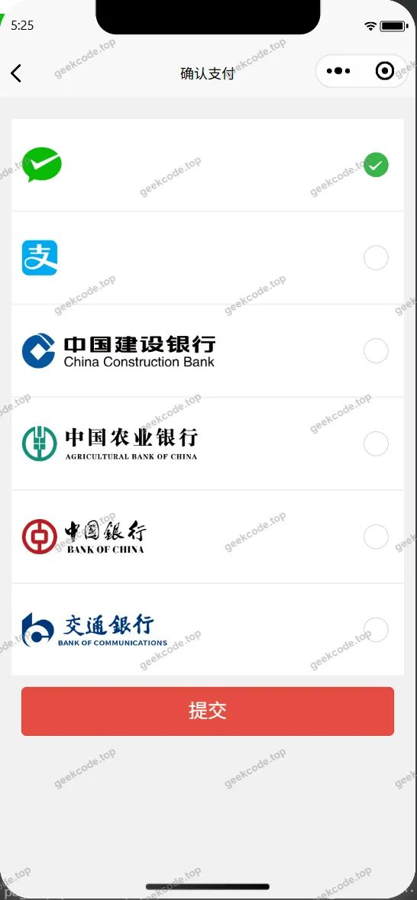</a><figcaption>小程序-payconfirm</figcaption></figure>

<h3>微信小程序管理端</h3>

<figure><a href="https://geekcode.top/archives/%E5%9F%BA%E4%BA%8E%E5%BE%AE%E4%BF%A1%E5%BE%AE%E6%9C%8D%E5%8A%A1%E6%9E%B6%E6%9E%84%E7%9A%84%E6%B1%BD%E8%BD%A6%E7%A7%9F%E8%B5%81%E7%B3%BB%E7%BB%9F%E7%9A%84%E8%AE%BE%E8%AE%A1%E4%B8%8E%E5%AE%9E%E7%8E%B0zaxzu?utm_source=github" title="查看完整源码">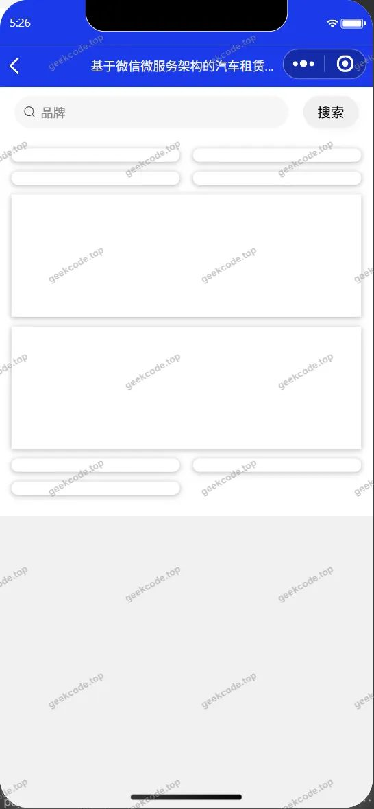</a><figcaption>小程序-管理端-车辆品牌列表</figcaption></figure>
<figure><figcaption>小程序-管理端-车辆颜色列表</figcaption></figure>
<figure><figcaption>小程序-管理端-关于我们列表</figcaption></figure>
<figure><figcaption>小程序-管理端-系统简介列表</figcaption></figure>
<figure><figcaption>小程序-管理端-用户列表</figcaption></figure>

<h3>后台管理端</h3>
<h4>后台-车辆颜色</h4>

<a href="https://geekcode.top/archives/%E5%9F%BA%E4%BA%8E%E5%BE%AE%E4%BF%A1%E5%BE%AE%E6%9C%8D%E5%8A%A1%E6%9E%B6%E6%9E%84%E7%9A%84%E6%B1%BD%E8%BD%A6%E7%A7%9F%E8%B5%81%E7%B3%BB%E7%BB%9F%E7%9A%84%E8%AE%BE%E8%AE%A1%E4%B8%8E%E5%AE%9E%E7%8E%B0zaxzu?utm_source=github" title="查看完整源码">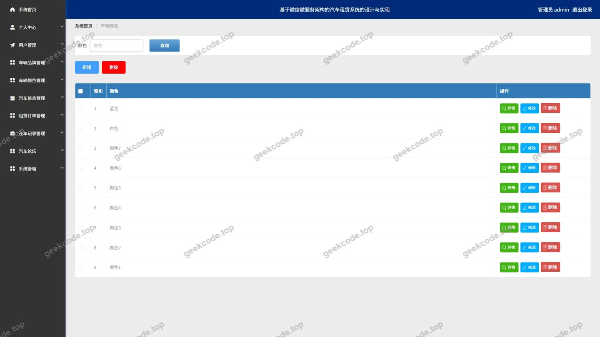</a>

<h4>后台-登录页</h4>

<h4>后台-公告信息</h4>

<a href="https://geekcode.top/archives/%E5%9F%BA%E4%BA%8E%E5%BE%AE%E4%BF%A1%E5%BE%AE%E6%9C%8D%E5%8A%A1%E6%9E%B6%E6%9E%84%E7%9A%84%E6%B1%BD%E8%BD%A6%E7%A7%9F%E8%B5%81%E7%B3%BB%E7%BB%9F%E7%9A%84%E8%AE%BE%E8%AE%A1%E4%B8%8E%E5%AE%9E%E7%8E%B0zaxzu?utm_source=github" title="查看完整源码">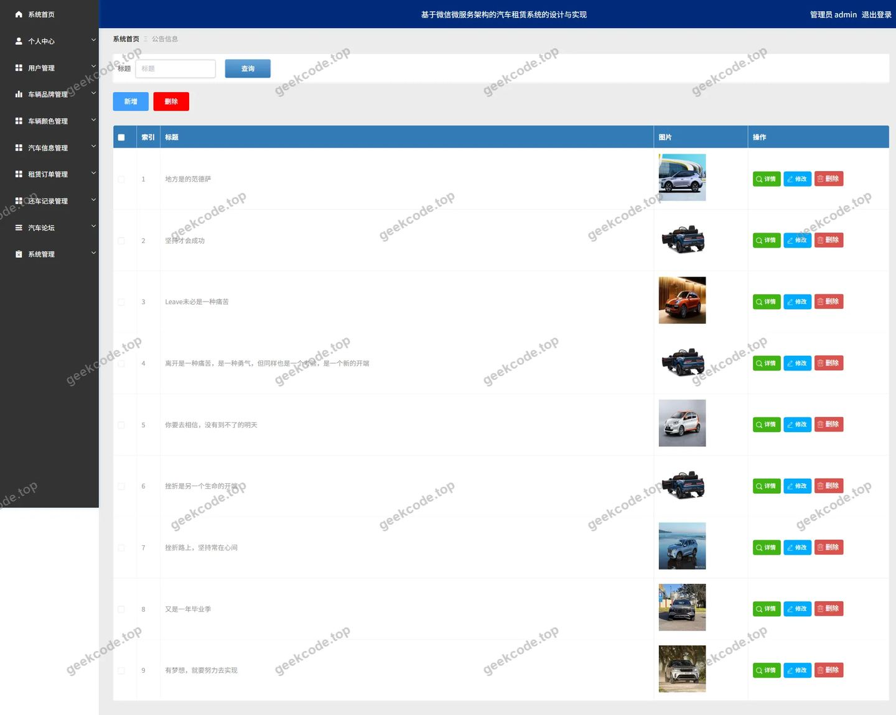</a>

<h4>后台-关于我们</h4>

<a href="https://geekcode.top/archives/%E5%9F%BA%E4%BA%8E%E5%BE%AE%E4%BF%A1%E5%BE%AE%E6%9C%8D%E5%8A%A1%E6%9E%B6%E6%9E%84%E7%9A%84%E6%B1%BD%E8%BD%A6%E7%A7%9F%E8%B5%81%E7%B3%BB%E7%BB%9F%E7%9A%84%E8%AE%BE%E8%AE%A1%E4%B8%8E%E5%AE%9E%E7%8E%B0zaxzu?utm_source=github" title="查看完整源码">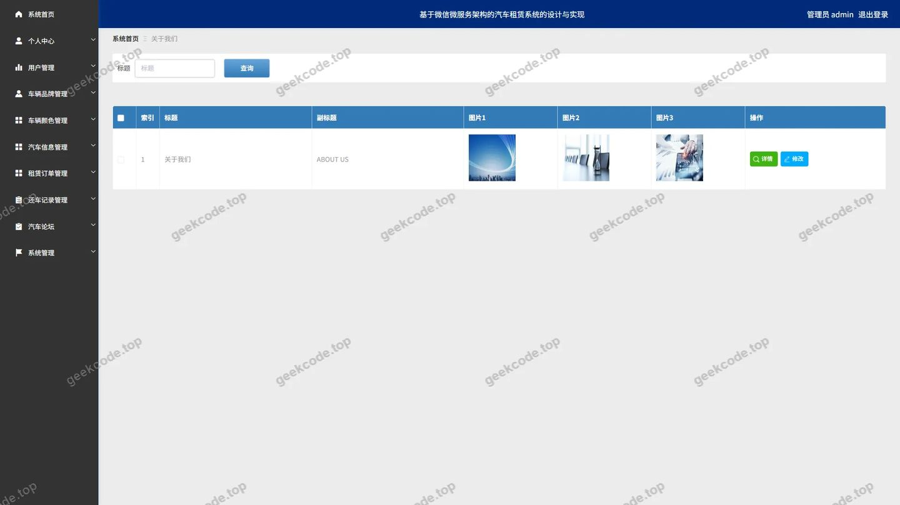</a>

<h4>后台-收藏</h4>

<a href="https://geekcode.top/archives/%E5%9F%BA%E4%BA%8E%E5%BE%AE%E4%BF%A1%E5%BE%AE%E6%9C%8D%E5%8A%A1%E6%9E%B6%E6%9E%84%E7%9A%84%E6%B1%BD%E8%BD%A6%E7%A7%9F%E8%B5%81%E7%B3%BB%E7%BB%9F%E7%9A%84%E8%AE%BE%E8%AE%A1%E4%B8%8E%E5%AE%9E%E7%8E%B0zaxzu?utm_source=github" title="查看完整源码">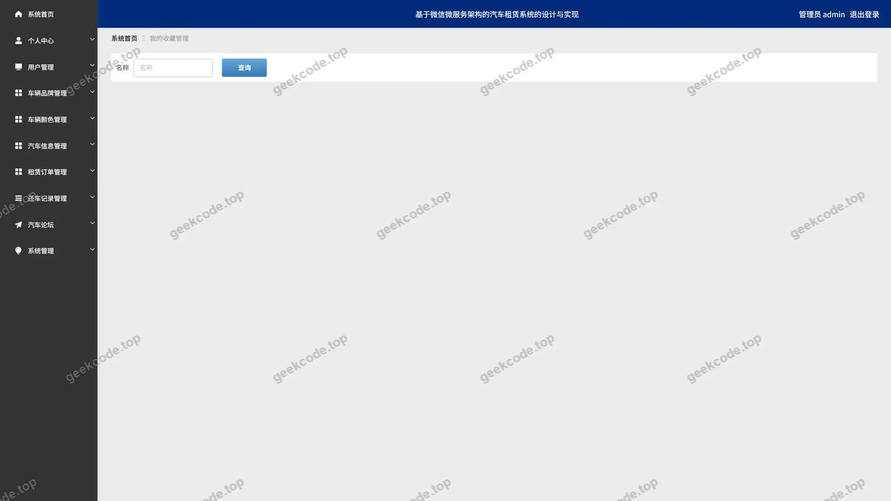</a>

<h4>后台首页</h4>

<a href="https://geekcode.top/archives/%E5%9F%BA%E4%BA%8E%E5%BE%AE%E4%BF%A1%E5%BE%AE%E6%9C%8D%E5%8A%A1%E6%9E%B6%E6%9E%84%E7%9A%84%E6%B1%BD%E8%BD%A6%E7%A7%9F%E8%B5%81%E7%B3%BB%E7%BB%9F%E7%9A%84%E8%AE%BE%E8%AE%A1%E4%B8%8E%E5%AE%9E%E7%8E%B0zaxzu?utm_source=github" title="查看完整源码">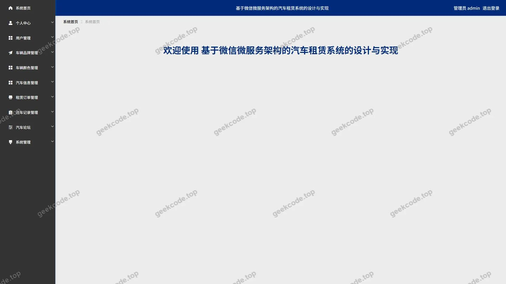</a>

<h4>后台-租赁订单</h4>

<a href="https://geekcode.top/archives/%E5%9F%BA%E4%BA%8E%E5%BE%AE%E4%BF%A1%E5%BE%AE%E6%9C%8D%E5%8A%A1%E6%9E%B6%E6%9E%84%E7%9A%84%E6%B1%BD%E8%BD%A6%E7%A7%9F%E8%B5%81%E7%B3%BB%E7%BB%9F%E7%9A%84%E8%AE%BE%E8%AE%A1%E4%B8%8E%E5%AE%9E%E7%8E%B0zaxzu?utm_source=github" title="查看完整源码">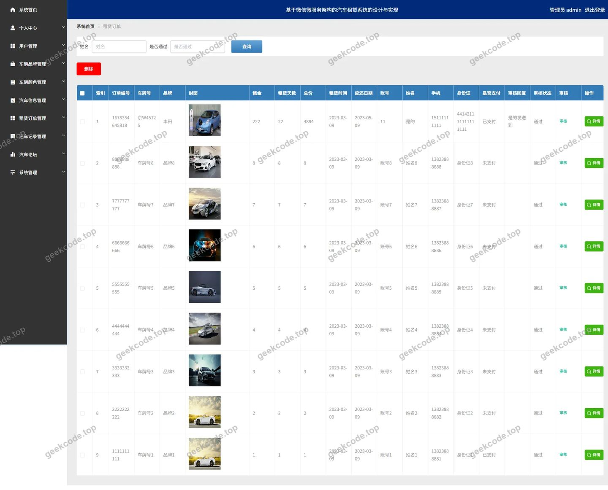</a>

<h4>后台-关于我们</h4>

<a href="https://geekcode.top/archives/%E5%9F%BA%E4%BA%8E%E5%BE%AE%E4%BF%A1%E5%BE%AE%E6%9C%8D%E5%8A%A1%E6%9E%B6%E6%9E%84%E7%9A%84%E6%B1%BD%E8%BD%A6%E7%A7%9F%E8%B5%81%E7%B3%BB%E7%BB%9F%E7%9A%84%E8%AE%BE%E8%AE%A1%E4%B8%8E%E5%AE%9E%E7%8E%B0zaxzu?utm_source=github" title="查看完整源码">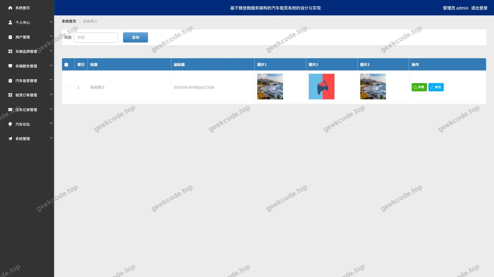</a>

---

## 获取完整源码

| 项目 | 说明 |
| --- | --- |
| 项目名 | 基于微信微服务架构的汽车租赁系统的设计与实现zaxzu |
| 运行截图 | 本文 26 张（站点带水印原图，仓库 `images/` 目录） |
| 完整源码 | [https://geekcode.top/archives/%E5%9F%BA%E4%BA%8E%E5%BE%AE%E4%BF%A1%E5%BE%AE%E6%9C%8D%E5%8A%A1%E6%9E%B6%E6%9E%84%E7%9A%84%E6%B1%BD%E8%BD%A6%E7%A7%9F%E8%B5%81%E7%B3%BB%E7%BB%9F%E7%9A%84%E8%AE%BE%E8%AE%A1%E4%B8%8E%E5%AE%9E%E7%8E%B0zaxzu?utm_source=github](https://geekcode.top/archives/%E5%9F%BA%E4%BA%8E%E5%BE%AE%E4%BF%A1%E5%BE%AE%E6%9C%8D%E5%8A%A1%E6%9E%B6%E6%9E%84%E7%9A%84%E6%B1%BD%E8%BD%A6%E7%A7%9F%E8%B5%81%E7%B3%BB%E7%BB%9F%E7%9A%84%E8%AE%BE%E8%AE%A1%E4%B8%8E%E5%AE%9E%E7%8E%B0zaxzu?utm_source=github) |
| 咨询微信 | **ir9372**（备注：jingpin-yuanma） |
| 更多项目 | [极客代码 geekcode.top](https://geekcode.top/?utm_source=github) |

> 需要源码、部署、改配置、跑不起来等问题，加微信 ir9372 沟通，说明项目名即可。
